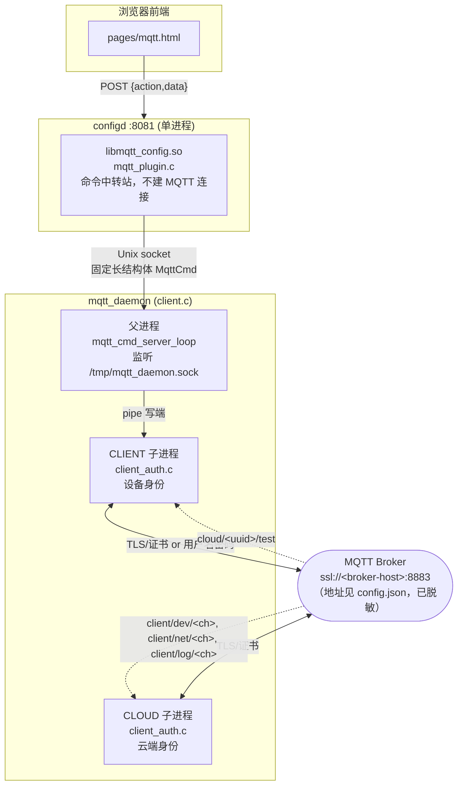
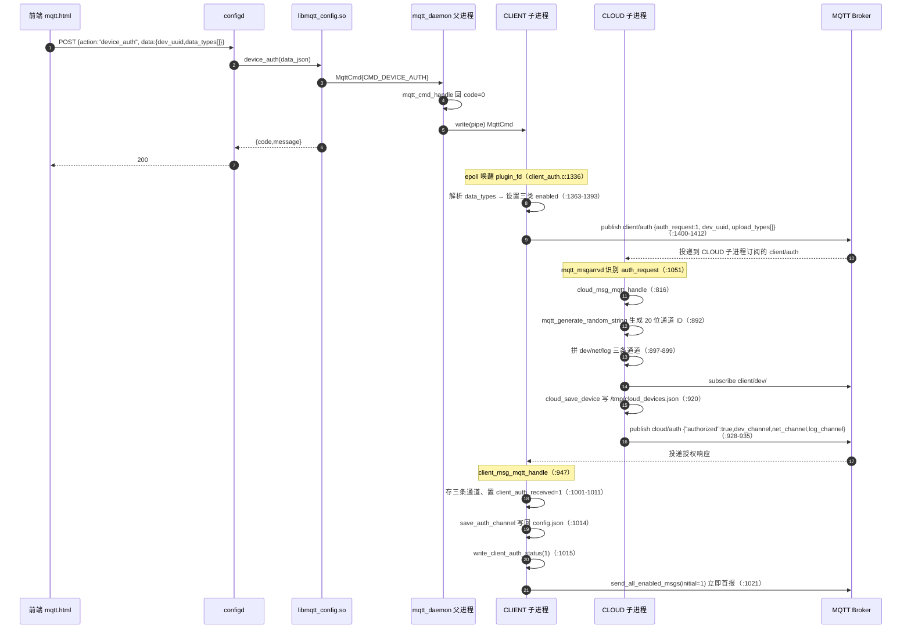
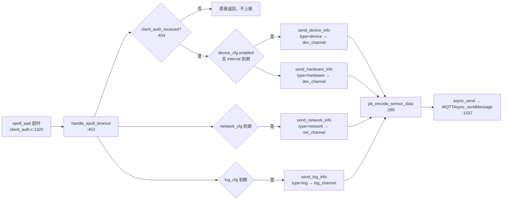
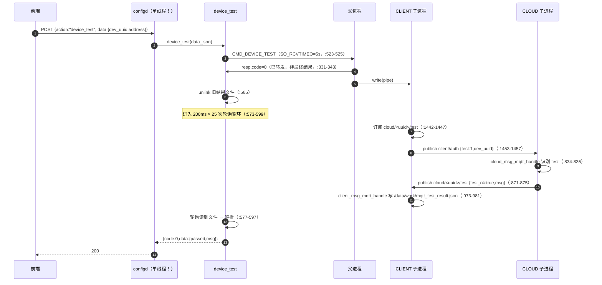

# waywardkoi 代码库说明文档

> 状态：**进行中** —— 已完成 **B1**（`configd` API 网关，§1）与 **B4**（`mqtt` 设备接入，§2）。
> 待补：B2 `admin_auth/auth.c`（§3）、B3 `admin_plugin.c`（§4）、B5 孤儿代码走查（§5）、B6 `libs/*` + `cert_manager`（§6），以及 §7–§9 汇总章节。
>
> 章节编号说明：编号沿用原阅读计划的批次号（B1/B4），**不表示阅读顺序**。建议阅读顺序为 **§1 → §2 → §3**。
>
> - 生成范围：`E:\waywardkoi`
> - 代码基准时间：源码最后修改时间 `2026-06-18 19:12:36`
> - 行号引用规则：`workspace/configd/configd.c:775` 表示该文件第 775 行；行号取自实际文件内容。

---

## 0. 阅读指引

| 你想做什么 | 从这里开始 |
|---|---|
| 加一个新的后端接口 | §1.7「如何新增一个 action」 |
| 查某个 HTTP 请求打到哪个函数 | §1.6 路由加载表 + `workspace/*/…_routes.json` |
| 排查「接口返回 -2 / -4」 | §1.8 错误码表 |
| 理解网关为什么是单线程 | §1.4 并发模型 |
| 上线前风险评审 | §1.9 风险清单 |

---

## 1. 模块 B1：`workspace/configd` —— HTTP API 网关

### 1.1 模块职责

`configd` 是整个后端**唯一的 HTTP 入口**。它本身不含任何业务逻辑，只做四件事：

1. 启动时扫描 `/var/json/*.json`，把每个文件的 `routes[]` 合并成一张全局 `action → (so 路径, 符号名)` 路由表；
2. 接收 HTTP `POST`，从 JSON body 取出 `action` 字段查表；
3. 用 `dlopen`/`dlsym` 加载对应 `.so` 并调用其中的函数；
4. 把插件返回的 JSON 字符串原样作为 HTTP 响应体写回。

因此**它的角色是「插件容器 + 协议适配层」**，业务全部在三个插件里（`libadmin.so`、`libcert_manager.so`、`libmqtt_config.so`）。这也解释了为什么改业务几乎从不需要动这个模块——只有改**协议**（请求体格式、错误码、鉴权、并发模型）才需要动它。

TLS 不由它负责：文件头注释 `workspace/configd/configd.c:1-60` 明确约定由 **Nginx 做 HTTPS 卸载**，`configd` 只监听明文 `8081`，所以 `workspace/configd/cert/` 下的 `server.crt`/`server.key` **当前没有被 configd 使用**（`workspace/configd/Makefile` 未链接 `-lssl`，`workspace/configd/configd.c:774-782` 使用纯 HTTP 启动参数）。这一点与工作区内存在证书的直觉相反，新成员容易误判。

### 1.2 关键文件

| 文件 | 行数 | 作用 |
|---|---|---|
| `workspace/configd/configd.c` | 804 | 全部逻辑，单文件 |
| `workspace/configd/Makefile` | 21 | `gcc -Wall -O2 -D_GNU_SOURCE -fstack-protector-strong -lmicrohttpd -lcjson -ldl -lpthread` |
| `workspace/configd/cert/server.crt` / `.key` | — | **未被代码引用**（按约定排除分析） |
| `workspace/configd/configd` | 32344 B | 编译产物，排除分析。构建时间 `2026-06-18 18:56:02`，**早于源码 `configd.c` 的 `22:20:15`**，见 §1.9 R7 |

### 1.3 全局状态与数据结构

| 符号 | 位置 | 含义 |
|---|---|---|
| `RouteEntry` | `configd.c:95-99` | 路由条目：`action[128]`、`library[256]`、`function[128]` |
| `g_routes` / `g_route_count` | `configd.c:101-102` | 全局路由表数组与条数；只在启动阶段写，之后只读 |
| `LibCache` | `configd.c:168-173` | 已加载 `.so` 的缓存节点：`path` / `handle` / `refcnt` / `next` |
| `g_libcache` + `g_cache_lock` | `configd.c:175-176` | 缓存链表头 + `pthread_rwlock_t` |
| `g_log_fp` + `g_log_mutex` | `configd.c:91-92` | 日志文件句柄与互斥锁 |
| `ConnectionContext` | `configd.c:575-580` | **每个 HTTP 连接**的请求体累积缓冲：`post_data`/`size`/`cap`/`body_received` |
| `g_running` / `g_daemon` | `configd.c:738-739` | 退出标志与 MHD 守护实例 |

四个编译期常量（`configd.c:84-89`）：`PORT 8081`、`JSON_DIR "/var/json"`、`LOG_FILE "/var/log/work_log/configd.log"`、`MAX_BODY_SIZE 1MB`（`MAX_HEADER_SIZE 256` 定义后**从未使用**，属死代码）。

### 1.4 并发模型（**这是本模块最容易被误读的地方**）

代码里存在 `pthread_rwlock_t g_cache_lock`（`configd.c:176`）、`pthread_mutex_t g_log_mutex`（`configd.c:92`）以及一套带 `refcnt` 引用计数的库缓存，**看起来是为多线程设计的**；但启动参数是：

```c
g_daemon = MHD_start_daemon(
    MHD_USE_SELECT_INTERNALLY,          /* configd.c:776 */
    PORT, NULL, NULL, ahc, NULL,
    MHD_OPTION_NOTIFY_COMPLETED, request_completed, ...);
```

`MHD_USE_SELECT_INTERNALLY` 且**未传 `MHD_OPTION_THREAD_POOL_SIZE`**、未用 `MHD_USE_THREAD_PER_CONNECTION`，因此 MHD 在**单线程**事件循环中回调 `ahc`。结论：

- 实际运行时 **所有插件调用都是串行的**，一个慢插件会阻塞全部请求（无请求超时、无并发上限）。
- 上述锁与引用计数**当前不产生并发收益**，属于「为未来多线程预留」，但同时带来了 §1.9 R3 的状态语义问题。
- 收益是：插件函数**不需要考虑线程安全**，可以放心用全局/静态变量。改动此模块（例如换成线程池）会**立即让三个插件的线程安全性成为阻塞项**，必须同步审计。

生命周期：`main` 起于 `configd.c:749`，停于 `796-803`。`g_running` 由信号处理器置 0（`741-747`，注释显式说明不在信号处理器内调用非异步信号安全的 `MHD_stop_daemon`），主循环 `while (g_running) sleep(1)`（`796`）——所以**关停最坏有 1 秒延迟**，且退出时按 `MHD_stop_daemon → libcache_clear → free_routes → close_log` 顺序清理（`798-801`）。

### 1.5 核心函数清单

| 函数 | 位置 | 用途 / 输入 / 输出 / 失败行为 | 调用方 |
|---|---|---|---|
| `main(int argc, char *argv[])` | `749` | 入参仅识别 `-d`（`751`）进入守护模式。顺序：`init_log`→`safe_mkdir(JSON_DIR)`→`load_all_routes`→注册信号→可选 `daemonize`→`MHD_start_daemon`→自旋。任一步失败返回 1（`753-767`, `784-790`） | 操作系统 |
| `ahc(...)` | `582` | **MHD 请求回调（访问处理器）**。参数 `url`/`method`/`upload_data`/`upload_data_size`/`con_cls`。统一处理 `/health`(GET)、`/status`(GET)、`OPTIONS`、非 POST 拒绝、body 累积，最后转 `process_request`。返回 `MHD_YES`/`MHD_NO` | libmicrohttpd |
| `process_request(conn, post_data, client_ip)` | `496` | **业务分发核心**。解析 JSON → 取 `action` → `find_route` → 取 `data` 对象序列化为 `data_str`（缺省 `"{}"`，`529-530`）→ 安全校验 → `libcache_get` → `dlsym` → 调用 `func(data_str, &http_status)` → 回写响应。无返回值，副作用是发送 HTTP 响应 | `ahc`（`692`） |
| `get_real_client_ip(conn, buf, bufsize)` | `105` | 客户端 IP 解析，优先级 `X-Real-IP` → `X-Forwarded-For`（取首个）→ 直连地址（`AF_INET`/`AF_INET6`）→ `"unknown"`。**直接信任请求头**，见 §1.9 R4 | `ahc`（`590`） |
| `is_https_from_nginx(conn)` | `150` | 判断原始协议：`X-Forwarded-Proto` 为 `https`/`http` 时按其值，缺失时回退 `X-Forwarded-Port == 443`。返回 0/1 | `ahc`（`591`） |
| `libcache_get(const char *path)` | `178` | 取（必要时加载）插件句柄，`refcnt++`。读锁查找 → 未命中则**在锁外 `dlopen`**（`194`，`RTLD_LAZY|RTLD_NODELETE`）→ 写锁双检插入。OOM/失败时 `dlclose` 并返回 `NULL` | `process_request`（`541`） |
| `libcache_release(const char *path)` | `231` | `refcnt--`，降到 0 时 `dlclose` + 摘链 + `free`。找不到路径则静默返回 | `process_request`（`554`, `564`） |
| `libcache_clear(void)` | `252` | 遍历释放全部缓存，仅退出时调用（`799`） | `main` |
| `is_path_safe(const char *libpath)` | `433` | **安全闸门**：`realpath` 解析后必须落在 `TRUSTED_LIB_DIR "/lib/work_lib/"`（`431`）的 `realpath` 结果前缀内，且剩余部分不得含 `..`。返回 1/0，失败记 ERROR 日志 | `process_request`（`533`） |
| `load_routes_from_file(const char *path)` | `316` | 读单个路由 JSON（限制 `0 < size <= 1MB`，`325`），要求顶层 `routes` 为数组（`344-349`），逐项校验 `action`/`library`/`function` 三字段均为字符串（`357-362`），缺字段则 `continue` 跳过该项。用 `realloc` 追加到 `g_routes` | `load_all_routes`（`397`） |
| `load_all_routes(void)` | `383` | `opendir(JSON_DIR)` 遍历 `.json`（后缀判断 `393`）。**目录打不开不阻断启动**（`384-388` 返回 0）；单文件失败只记日志继续（`396-399`）；最后做 O(n²) 重复 `action` 检测（`404-410`） | `main`（`762`） |
| `find_route(const char *action)` | `419` | 线性查找，命中返回 `RouteEntry*`，否则 `NULL` | `process_request`（`516`） |
| `send_json_response(conn, status, json, len)` | `467` | 创建响应并统一附加 `Content-Type: application/json` 与 CORS 三个头。用 `MHD_RESPMEM_MUST_FREE`（`471`）——**接管 `json` 所有权并 free**；若 `MHD_create_response_from_buffer` 失败则自行 `free`（`474`），这种所有权约定是调用方必须遵守的隐式契约 | 全模块 |
| `create_error_json(code, msg)` | `486` | 构造 `{"code":..,"message":..}`，返回 `cJSON_Print` 出的**堆字符串（调用方负责释放）** | 全模块 |
| `log_write(level, fmt, ...)` | `267` | 带时间戳与互斥的日志；`g_log_fp` 为空时降级到 `stderr`（`269-278`） | `LOG_INFO`/`LOG_ERROR` 宏（`293-294`） |
| `init_log` / `close_log` / `safe_mkdir` | `302` / `309` / `296` | 日志初始化（含 `mkdir /var/log/work_log`）、关闭、容错建目录（`EEXIST` 视为成功） | `main` |
| `daemonize(void)` | `711` | 经典双 `fork` + `setsid` + `chdir("/")` + `close(0)`（`720`），把 stdout/stderr 重定向到日志文件，失败则退到 `/dev/null`（`726-734`） | `main`（`772`） |
| `request_completed(...)` | `699` | MHD 连接结束回调，释放 `ConnectionContext`，**防止连接提前断开时内存泄漏** | libmicrohttpd |

### 1.6 HTTP 接口（网关自身）

网关自身只暴露 3 个非业务端点，其余全部走 `/`（任意路径）的 POST 分发——**注意 `ahc` 不校验 `url`**，`/config/xxx`、`/api/yyy`、`/` 对 `configd` 完全等价，路径区分只发生在 Nginx 层。

| 方法 | 路径 | 请求 | 响应 | 位置 |
|---|---|---|---|---|
| GET | `/health` | 无 | 空 body（200）；回显头 `X-Real-IP`、`X-Forwarded-Proto` | `594-603` |
| GET | `/status` | 无 | `{"service":"configd","status":"running","routes":<N>}` | `606-618` |
| OPTIONS | 任意 | 无 | 空 body（200），CORS 预检头含 `Allow-Credentials: true`、`Max-Age: 86400` | `620-630` |
| POST | 任意 | 见下方契约 | 插件返回的 JSON | `632-696` → `496` |

**业务请求契约**（`process_request` 解析，`499-531`）：

```jsonc
// 请求
{ "action": "<路由表 action 名>", "data": { /* 任意对象，可选 */ } }
// 响应（由插件决定，网关不包装）
{ "code": <int>, "message": "<str>", "data": { /* ... */ } }
```

插件函数签名（网关侧 typedef，`configd.c:550-551`）：

```c
typedef char* (*plugin_func)(const char*, int*);
// 入参1: data 对象序列化后的 JSON 字符串（无 data 时为 "{}"，configd.c:530）
// 入参2: 出参，插件写入期望的 HTTP 状态码（初值 200，configd.c:561）
// 返回: 堆分配的 JSON 字符串，网关用 strlen 计算长度后交给 MHD 释放
```

**该 ABI 已被三个插件一致实现**（已核对，均为 `char* f(const char *data_json, int *out_status)`）：

| 插件 | 验证到的符号 |
|---|---|
| `workspace/admin_auth/admin_plugin.c` | `admin_create:290`、`admin_read:390`、`admin_get:450`、`admin_update:481`、`admin_delete:699`、`admin_update_auth_policy:761`、`admin_totp_generate:835`、`admin_log_query:970` |
| `workspace/cert_manager/cert_plugin.c` | `list_certs:190`、`create_cert:283`、`revoke_cert:460`、`cert_init:544` |

（`libmqtt_config.so` 的 13 个符号待 B5 核对。）

### 1.7 如何新增一个 action（端到端改动清单）

1. 在插件 `.c` 中实现 `char* my_action(const char *data_json, int *out_status)`，返回 `cJSON_Print` 出来的字符串，并设置 `*out_status`；**必须返回非 NULL**，否则网关回 `-99`（`566-569`）。
2. 重新 `make` 该插件，安装到 `/lib/work_lib/`（`Makefile` 的 `install` 目标）。
3. 在 `/var/json/` 下任意路由 JSON 的 `routes[]` 增加一条 `{action, library, function}`。`library` 必须位于 `/lib/work_lib/` 下，否则被 `is_path_safe` 拦为 `-4`（`533-539`）。
4. **重启 `configd`**——路由表只在启动时加载一次（`762`），代码中**没有 SIGHUP 重载机制**，这是运维上的硬约束。
5. 若需 Nginx 暴露新路径，同步改 Nginx `location`（模板见 `configd.c:22-57`），因为网关不区分路径。

### 1.8 错误码表

| `code` | HTTP | 触发条件 | 位置 |
|---|---|---|---|
| `-1` | 400 | body 非合法 JSON 时为 `-3`；缺少/空 `action` 为 `-1`；非 POST 方法也是 `-1` | `507-513`, `632-635` |
| `-2` | 400 | `action` 未在路由表中 | `517-523` |
| `-3` | 400 | `cJSON_Parse` 失败 | `499-504` |
| `-4` | 403 / 500 | 插件路径不安全（403）；`dlopen` 失败（500）；`dlsym` 失败（500）。**同一码复用了 3 种语义**，客户端无法区分 | `533-559` |
| `-5` | 413 / 500 | body 超 1MB（413）；累积缓冲 `realloc` 失败（500） | `645-663` |
| `-99` | 500 | 插件返回 `NULL` | `566-569` |

注意：`-1` 同时承担「缺 action」和「方法不允许」，而「非法 JSON」是 `-3`——这套编码**没有文档、也无集中定义**，是靠 `create_error_json` 调用点分散维护的。

### 1.9 风险清单（B1）

| ID | 严重度 | 问题 | 证据 | 说明与建议 |
|---|---|---|---|---|
| **R1** | 高 | **网关不做任何鉴权** | `configd.c:496-572` 无 token/session 校验；仅 `477-480` 加了 `Access-Control-Allow-Origin: *` | 全部管理能力（`admin_create`/`admin_delete`/`revoke_cert`/`device_stop`）经此暴露。唯一防线是 Nginx + 前端，而 Nginx 配置**不在本工作区**（文件头只是注释示例）。建议在 `process_request` 查表后、调用插件前插入统一鉴权钩子；并把 CORS 收敛为白名单 |
| **R2** | 高 | **CORS 通配 + 允许凭据** | `configd.c:478`（`*`）与 `623`（`Allow-Credentials: true`） | 两处并存属危险组合。建议改为固定域名白名单 |
| **R3** | 中 | 插件**每次请求都被 `dlclose`**，静态状态不跨请求保留 | `libcache_release:237-243` 在 `refcnt<=0` 时 `dlclose`；`process_request:564` 每请求调用一次 | 虽然 `dlopen` 用了 `RTLD_NODELETE`（`194`），但 `dlclose` 仍会执行析构函数（`__attribute__((destructor))` / C++ 静态析构），插件内 `static` 变量语义在「重载 vs 不重载」之间**依赖 libc 行为，属于脆弱假设**。若插件缓存了配置或连接，可能每次请求重建。建议改为常驻持有（启动时预加载、`refcnt` 不归零） |
| **R4** | 中 | **客户端 IP 可伪造** | `get_real_client_ip:111-132` 无条件信任 `X-Real-IP`/`X-Forwarded-For` | 当前仅用于日志，风险有限；一旦将来用 IP 做审计或限流即成漏洞。建议只信任来自 127.0.0.1 的转发头 |
| **R5** | 中 | **单线程串行，无超时与限流** | `configd.c:775-782` `MHD_USE_SELECT_INTERNALLY` 且无线程池；`process_request:562` 同步调用插件 | 任一插件阻塞（如 `cert_manager` 内的 `system("openssl ...")`，`cert_plugin.c:165`）会**冻结整个网关**。建议启用 `MHD_OPTION_THREAD_POOL_SIZE`，但须先完成插件线程安全审计（见 §1.4） |
| **R6** | 中 | 路由表**无热重载**，`action` 重复仅告警不报错 | `load_all_routes:404-410`（只 `LOG_ERROR`）；无 reload 入口 | 重复 action 时静默采用「最后注册」（实际是同一对中较大的下标），行为依赖 `readdir` 顺序，**不可预测**。建议重复即启动失败，并增加 SIGHUP 重载 |
| **R7** | 中 | **工作区内二进制与源码不同步** | `configd` 构建于 `2026-06-18 18:56:02`，而 `configd.c` 修改于 `22:20:15` | 仓库里的 `configd` 是**过期产物**；`admin_plugin.c`（`19:12:36`）更是晚于 `configd`，且**没有对应的 `libadmin.so`**。据此无法从产物反推线上真实版本。建议清理产物、改为 CI 构建并记录版本 |
| **R8** | 低 | `is_path_safe` 前缀匹配非目录边界比较，且 `..` 检查是冗余的 | `configd.c:450-460` | `realpath` 已消除 `..` 与符号链接，`457` 行检查实际永不命中（死代码）；前缀比较若受信目录为 `/lib/work_lib/`，`/lib/work_lib_evil/x.so` 会被 `strncmp` 判为通过（差一个 `/` 边界）。建议补目录分隔符校验并删掉死代码 |
| **R9** | 低 | 每次请求都打 INFO 日志 | `is_path_safe:462`、`process_request:497`、`load_routes_from_file:376` | 高频接口下日志放大，且**无日志轮转**（`init_log:304` 只 `fopen("a")`），`/var/log/work_log/configd.log` 会无限增长 |
| **R10** | 低 | 死代码与可读性 | `configd.c:89` `MAX_HEADER_SIZE` 定义未使用；`-4` 语义重载（§1.8） | 建议清理 |
| **R11** | 低 | `daemonize` 在成功重定向后**没有处理 fd 0** | `configd.c:720-734`：先 `close(0)`，随后仅在打开日志**失败**的分支里才把 0 指向 `/dev/null` | 成功分支下进程 fd 0 处于关闭状态，后续任何读 stdin 的代码会拿到 `EBADF`；当前无此代码，属潜在隐患 |
| **R12** | 低 | `daemonize` 后日志句柄双重打开 | `init_log:304` 已 `fopen(LOG_FILE)`，`daemonize:721` 又 `open` 同一文件给 stdout/stderr | 产生两个独立文件描述符与两套缓冲，时间戳可能交错。建议 daemonize 后统一重开日志 |
| **R13** | 信息 | `ahc` 不校验 URL，所有路径等价 | `configd.c:582-696` 从未使用 `url` 做路由 | 依赖 Nginx 隔离；若 `configd:8081` 被直接暴露，则任何路径均可调用任意 action。建议绑定 `127.0.0.1` 或加来源校验 |
| **R14** | 信息 | **本模块无任何测试** | 工作区无 `test/`、无 CI 配置、无 `.git` | `is_path_safe`、`libcache_*`、`load_routes_from_file` 都是纯函数/易测逻辑，建议优先补单元测试 |

### 1.10 修改指引（改什么动哪里）

| 需求 | 需要改的文件 |
|---|---|
| 加/改一个业务接口 | 对应插件 `.c` + `/var/json/*.json` 路由；**不必改 `configd.c`** |
| 改请求/响应包格式 | `workspace/configd/configd.c:496-572`（`process_request`）+ **全部**插件 |
| 加鉴权 | `workspace/configd/configd.c:516-541` 之间插入；另需前端/Nginx 配合 |
| 提高并发 | `workspace/configd/configd.c:775-782` + 三个插件线程安全审计 + `workspace/configd/Makefile`（已有 `-lpthread`） |
| 改端口/日志路径/体积上限 | `workspace/configd/configd.c:84-88` |
| 换受信插件目录 | `workspace/configd/configd.c:431` + 各 `Makefile` 的 `install` 目标 |

---

---

## 2. 模块 B4：`workspace/mqtt` —— 设备接入与云端桥接

> 说明：B4 与 B5 同属 `workspace/mqtt`，二者耦合极紧（同一套 `mqtt_cmd.h` 协议、同一份 `config.json`、同一批 `.c` 文件被 `mqtt_daemon` 一起编译）。为避免重复叙述，本章覆盖 **`common/` + `client/` + `plugin/` 的证据链与协议**，B5 只补 `cloud_server.c` / `device_client.c` 这两个孤儿文件的代码走查。

### 2.1 模块职责

`workspace/mqtt` 实现「设备接入云端 + 数据上报 + 云端管理设备」的完整闭环，它由**四个可执行体/产物**组成，理解它们的分工是读懂本模块的前提：



关键设计意图（为什么这样分）：**插件不允许建立 MQTT 连接**（`workspace/mqtt/plugin/mqtt_plugin.c:4-5` 明确注释「本插件只是命令中转站」）。原因是 `configd` 是单线程长驻进程，而 Paho MQTTAsync 会起自己的网络线程并长期持有 socket；把长连接放进插件会让进程生命周期与连接生命周期纠缠。因此改为「插件只写 Unix socket，真正的 MQTT 连接由独立守护进程 `mqtt_daemon` 持有」。

### 2.2 关键文件

| 文件 | 行数 | 角色 |
|---|---|---|
| `workspace/mqtt/common/mqtt_lib.h` | 178 | 数据结构与对外 API 声明；定义 `CONFIG_FILE_PATH`（**硬编码**，`:25`） |
| `workspace/mqtt/common/mqtt_lib.c` | 624 | 配置加载、Unix socket 服务端、命令分发 `mqtt_cmd_handle` |
| `workspace/mqtt/common/mqtt_cmd.h` | 43 | 命令协议：常量、`MqttCmd`/`MqttCmdResp`、命令类型 |
| `workspace/mqtt/common/mqtt_cmd.c` | 46 | 客户端侧命令发送 `mqtt_cmd_send` |
| `workspace/mqtt/common/client_auth.c` | 1556 | **核心业务**：MQTT 连接、认证握手、数据上报、设备数据落盘 |
| `workspace/mqtt/common/sensor.proto` + `.pb-c.{c,h}` | 8 / 142 / 54 | `SensorData` 消息定义与**生成代码**（排除逐行分析） |
| `workspace/mqtt/client/client.c` / `.h` | 186 / 8 | 守护进程入口：建 socket、双 fork、管道、父进程收命令 |
| `workspace/mqtt/plugin/mqtt_plugin.c` | 738 | 13 个 action 的插件实现 |
| `workspace/mqtt/plugin/cloud_server.c` / `.h` | 393 / 52 | **孤儿代码**，见 §2.3 |
| `workspace/mqtt/plugin/device_client.c` / `.h` | 294 / 37 | **孤儿代码**，见 §2.3 |
| `workspace/mqtt/file/mqtt.json` | 83 | 13 条 action→函数 路由表（安装到 `/var/json/mqtt.json`） |
| `workspace/mqtt/file/config.json` | 22 | Broker 地址、四组 clientid/topic、QoS、TLS 与凭据 |
| `workspace/mqtt/certs/*` | — | CA/server/client 三套证书与私钥（按约定排除分析） |

构建关系（`workspace/mqtt/plugin/Makefile:11-25`）——**这是最容易看错的地方**：

```
mqtt_daemon      = client.c + mqtt_lib.c + client_auth.c + mqtt_cmd.c + sensor.pb-c.c
libmqtt_config.so = mqtt_plugin.c  （单独编译，不含任何 common/*.c）
libmqtt_common.so = common/*.c     （由 common/Makefile 构建，但 mqtt_daemon 并不链接它）
```

`workspace/mqtt/plugin/Makefile:5` 的注释「Daemon 直接编译 common 源文件，无需链接 libmqtt_common.so」解释了这一取舍：避免运行时依赖 `LD_LIBRARY_PATH`。**副作用**是 `common/*.c` 被编译两遍（一份进 `mqtt_daemon`，一份进 `libmqtt_common.so`），而后者除了 `make install` 拷到 `/usr/local/lib` 外**没有任何消费者**——属于冗余产物。

### 2.3 ⚠️ 架构现状：新旧两套 MQTT 实现并存，旧的一套已成孤儿

模块内存在**两代互不兼容的实现**，这是本模块最大的认知陷阱：

| 维度 | 旧实现（孤儿） | 新实现（在用） |
|---|---|---|
| 文件 | `plugin/cloud_server.c`、`plugin/device_client.c` | `common/client_auth.c` + `client/client.c` |
| 结构体 | `CloudServer`/`DeviceRecord`（`cloud_server.h:19-43`）、`DeviceClient`（`device_client.h:21-29`） | `Context`（`mqtt_lib.h:39-69`）、`Mqtt_data`（`mqtt_lib.h:79-114`） |
| 并发模型 | `pthread` + 互斥量 + 条件变量（`cloud_server.h:41-42`、`device_client.h:27-28`） | `fork` 双进程 + `epoll`（`client.c:97-163`、`client_auth.c:1288-1332`） |
| 主题设计 | `client/dev/+/auth`、`client/dev/%s/data`（`cloud_server.h:13-15`、`device_client.h:14-17`） | `client/auth`、`client/dev/<ch>`、`cloud/<uuid>/test`（`config.json:4-10`、`client_auth.c:897-899`） |
| 数据组织 | 内存 `DeviceRecord devices[256]`（`cloud_server.h:39`） | 文件 `/tmp/cloud_devices.json`、`/tmp/cloud_device_<uuid>.json` |
| 是否被编译 | **否**（`plugin/Makefile:11,14` 的源文件列表不含二者） | 是 |
| 是否被引用 | **否**（全库 grep `cloud_server.h` / `device_client.h` 无任何 `#include`） | 是 |

结论：**`cloud_server.c/h` 与 `device_client.c/h` 共 776 行是没有构建入口、没有调用方的死代码**。它们不是「第三方库」，但一样不该按在用逻辑阅读。建议直接删除或移入 `legacy/` 并加注释，否则新人极可能照着 `DeviceRecord` 去改（而线上跑的是 `Mqtt_data`）。`workspace/mqtt/plugin/device_client.c:236` 那句 `TODO: real implementation` 也属于这套废弃代码，**不影响线上行为**——这一点很重要，避免误判为线上缺陷。

### 2.4 对外可见函数（公开 API）

分三张表：**A. `mqtt_lib.h` 声明的公共库 API**、**B. `mqtt_cmd.h` 声明的命令协议 API**、**C. `client.h` + 插件 action**。

#### A. `workspace/mqtt/common/mqtt_lib.h` 声明的公共 API

| 函数原型 | 位置 | 用途 / 参数 / 返回 / 异常 | 调用方 |
|---|---|---|---|
| `Context* mqtt_config_load(const char *path)` | 声明 `mqtt_lib.h:131`，实现 `mqtt_lib.c:143` | 加载配置到新建 `Context`。**参数 `path` 被 `(void)path` 完全忽略**（`mqtt_lib.c:144`），实际读 `CONFIG_FILE_PATH`。失败路径全部 `exit(1)`（`:151`、`:48`、`:58`、`:63`、`:73`）——**本函数只会返回有效指针或终止进程** | `client.c:76`、`:120`、`:155` |
| `void mqtt_config_free(Context *ctx)` | `mqtt_lib.h:136` / `mqtt_lib.c:246` | 释放 `ctx`，**并顺带销毁全局 `g_config_root`**（`:247-250`）。释放后必须重新 `mqtt_config_load`，否则后续 `config_get_string` 触发 `config_init` 重读 | `client.c:90,100,119,126,135,154,161,178` |
| `char* mqtt_config_read_string(const char *name)` | `mqtt_lib.h:147` / `mqtt_lib.c:257` | 读配置字符串，返回 `strdup` 的堆串（**调用方必须 `free`**），缺失返回 `NULL` 并记日志（`:87`） | `client_auth.c:1177`（读 `auth_channel`）、`:933`（读 `cloud_pub_topic`） |
| `int mqtt_config_read_int(const char *name)` | `mqtt_lib.h:154` / `mqtt_lib.c:264` | 经 `atoi` 转换；**值缺失时返回 0，无法与「配置就是 0」区分** | 当前无调用方 |
| `void mqtt_generate_random_string(char *str, int len)` | `mqtt_lib.h:161` / `mqtt_lib.c:551` | 生成小写字母随机串。**内部 `srand(time(NULL))`（`:555`），每次调用重新播种** → 同一秒内多次调用产生**相同结果**，且非密码学安全 | `client_auth.c:892`（生成 20 字符通道 ID） |
| `char* Read_File_Content(const char *name)` | `mqtt_lib.h:165` / `mqtt_lib.c:568` | `@deprecated` 包装 `config_get_string` | 无 |
| `void generate_random_string(char *str)` | `mqtt_lib.h:167` / `mqtt_lib.c:575` | `@deprecated`，固定长度 20 | 无 |
| `int save_auth_channel(const char *auth_channel)` | `mqtt_lib.h:174` / `mqtt_lib.c:583` | 把 `auth_channel` 写入**配置文件本体** `CONFIG_FILE_PATH`（`:591`），即 `/home/workspace/mqtt/file/config.json`。返回 0/‑1 | `client_auth.c:1014`、`:1475` |
| `int save_devices_list(const char *devices_json)` | `mqtt_lib.h:175` / `mqtt_lib.c:611` | 写入 `/tmp/mqtt_devices.json`（`:612`）。**与实际使用的 `/tmp/cloud_devices.json`（`client_auth.c:704`）不是同一文件** | 无调用方 |
| `void log_message_impl(const char *file, int line, const char *format, ...)` | `mqtt_lib.h:22` / `mqtt_lib.c:7` | 日志实现，**每次调用 `fopen`+`fclose`**（`:8`、`:26`）。经宏 `log_message(...)`（`mqtt_lib.h:20`）自动补 `__FILE__`/`__LINE__` | 全模块 |
| `extern int g_client_cmd_fd` | `mqtt_lib.h:171` / 定义 `mqtt_lib.c:36` | 全局：client 子进程管道写端（初值 ‑1） | `client.c:169` 赋值，`mqtt_lib.c:319,334,351` 使用 |

#### B. `workspace/mqtt/common/mqtt_cmd.h` 声明的命令协议 API

| 函数原型 | 位置 | 用途 / 参数 / 返回 | 调用方 |
|---|---|---|---|
| `int mqtt_cmd_send(int cmd_type, const char *json_data, MqttCmdResp *resp)` | 声明 `mqtt_cmd.h:35`，实现 `mqtt_cmd.c:4` | 客户端侧：连 `/tmp/mqtt_daemon.sock`，发送 `MqttCmd` 结构体并读回 `MqttCmdResp`。返回 0/‑1。**正确处理了短读短写**（`mqtt_cmd.c:29-33`、`38-42`），但**无超时** | 当前无调用方（插件自己实现了一份，见 §2.5） |
| `int mqtt_cmd_server_create(const char *socket_path)` | `mqtt_cmd.h:38` / `mqtt_lib.c:272` | 创建 UNIX socket：`unlink` → `socket` → `bind` → **`chmod 0666`**（`:288`）→ `listen(5)`。返回监听 fd 或 ‑1 | `client.c:60` |
| `void mqtt_cmd_server_close(const char *socket_path)` | `mqtt_cmd.h:39` / `mqtt_lib.c:301` | 仅 `unlink`，**不关闭 fd** | `client.c:80,92,106,141,177` |
| `void mqtt_cmd_server_loop(int cmd_sock)` | `mqtt_cmd.h:40` / `mqtt_lib.c:499` | 父进程主循环：`select` 1 秒超时，`accept` 后同步读一条命令、处理、回写一条响应。**`while(1)` 无退出条件**（`:505`） | `client.c:173` |
| `void mqtt_cmd_handle(MqttCmd *cmd, MqttCmdResp *resp)` | `mqtt_cmd.h:41` / `mqtt_lib.c:308` | 命令分发核心（`switch`），见 §2.6 | `mqtt_lib.c:529` |

#### C. `client.h` 与插件 action 函数

| 函数原型 | 位置 | 说明 |
|---|---|---|
| `int mqtt_msg_handle(Context *file_data)` | 声明 `client.h:6`，实现 `client_auth.c:1107` | **子进程主函数**：建 MQTT 客户端、注册回调、连接、订阅、跑 epoll 主循环。返回 `rc`（0 或 `EXIT_FAILURE`） |
| `char* <action>(const char *data_json, int *out_status)` × 13 | `mqtt_plugin.c:121,140,157,170,183,200,217,322,360,425,464,628,687` | 插件 ABI，与 `configd` 约定的 `typedef char*(*)(const char*, int*)` 一致（见 §1.6）。13 个符号与 `workspace/mqtt/file/mqtt.json:3-82` 的 13 条路由**一一对应** |

13 个 action 速查（完整签名均为 `char* f(const char *data_json, int *out_status)`）：

| action | 实现位置 | 作用 | 是否触达 daemon |
|---|---|---|---|
| `device_auth` | `mqtt_plugin.c:121` | 触发设备发认证请求 | ✅ `CMD_DEVICE_AUTH` |
| `cloud_connect` | `:140` | 通知云端连接 | ✅ `CMD_CLOUD_CONNECT` |
| `cloud_disconnect` | `:157` | 通知云端断开 | ✅ `CMD_CLOUD_DISCONNECT` |
| `device_stop` | `:170` | 停止设备上报 | ✅ `CMD_DEVICE_STOP` |
| `get_auth_devices` | `:183` | 已授权设备列表 | ✅ `CMD_GET_DEVICES` |
| `get_device_detail` | `:200` | 单设备详情 | ✅ `CMD_GET_DEVICE_DETAIL` |
| `get_config` | `:217` | **直接读 `config.json` 并整份返回**（含密码/私钥路径） | ❌ 纯文件读 |
| `save_mqtt_address` | `:322` | 保存地址到 `/data/work/mqtt_addr.b64` | ❌ |
| `get_mqtt_address` | `:360` | 读取地址 | ❌ |
| `get_uuid` | `:425` | 读 `/sys/class/dmi/id/product_uuid` | ❌ |
| `device_test` | `:464` | 端到端连通性测试（**同步阻塞轮询 5 秒**） | ✅ `CMD_DEVICE_TEST` |
| `save_client_state` | `:628` | 存 `/data/work/client_state.b64` | ❌ |
| `get_client_state` | `:687` | 读状态并合并实时认证位 | ❌ |

### 2.5 内部函数（static，仅模块内可见）

按文件分组，只列有分析价值的。

**`workspace/mqtt/common/mqtt_lib.c`**

| 函数 | 位置 | 说明 |
|---|---|---|
| `config_init(void)` | `:42` | 懒加载配置到全局 `g_config_root`（`:33`）。**失败一律 `exit(1)`**，把配置错误升级为进程退出。无锁、非线程安全 |
| `config_get_string(const char *name)` | `:82` | 取字符串并 `strdup`；缺失返回 `NULL`（`:88`） |
| `config_get_int(const char *name)` | `:96` | 经 `config_get_string` + `atoi`；缺失返回 0 |
| `config_get_msg_array(name, qos, interval, enabled)` | `:111` | 解析形如 `[qos, interval]` 的数组；任一指针可为 `NULL` 跳过 |
| `get_real_client_ip`… | — | 属 B1，不在此 |

**`workspace/mqtt/common/client_auth.c`**（共 42 个函数，按职责分组）

| 函数 | 位置 | 说明 |
|---|---|---|
| `write_client_auth_status(int)` / `read_client_auth_status(void)` | `:54` / `:64` | 认证位落盘 `/data/work/client_auth_status`（`:52`），供插件跨进程读取。`write` 每次 `mkdir("/data/work")`（`:56`） |
| `read_file(path, buf, len)` | `:74` | 读首行并去掉 `\r\n`；失败返回 ‑1 |
| `get_system_info_json` | `:85` | 采集 hostname/DMI/CPU/内存/磁盘/uptime，**用 `snprintf` 手工拼 JSON**（`:150-160`）。注意 `dev_uuid`、`hostname` 等直接插入，未做 JSON 转义 |
| `get_hardware_info_json` | `:164` | 两次读 `/proc/stat` 求 CPU 使用率，依赖 `static prev_idle/prev_total`（`:166`）保存上次采样 |
| `get_network_info_json` | `:222` | 采集网络信息 |
| `get_log_info_json` | `:276` | 采集日志信息 |
| `pb_encode_sensor_data` | `:285` | 组装 `SensorData` 并 `sensor_data__pack`；返回 `malloc` 缓冲（调用方 `free`），失败 `NULL` |
| `pb_decode_sensor_data` | `:303` | `sensor_data__unpack` 包装；返回需 `sensor_data__free_unpacked` 释放 |
| `send_device_info` / `send_hardware_info` / `send_network_info` / `send_log_info` | `:309` / `:325` / `:340` / `:356` | 四类上报。**统一前置条件 `enabled && client_auth_received`**。注意 `send_hardware_info` **不更新任何 `last_send`**（对比 `:321`、`:352`、`:368`） |
| `send_all_enabled_msgs(data, initial)` | `:373` | `initial=1` 立即全发；`initial=0` 按 `last_send + interval` 判断 |
| `get_next_timeout_ms(data)` | `:408` | 计算 epoll 等待时长。未认证时固定 1000ms（`:410`）；否则取三类间隔最小值 ×1000。**注意默认 `min_timeout=1000` 秒**（`:414`），未启用的类型不会被计入，因此实际由启用项决定 |
| `handle_epoll_timeout(void)` | `:453` | 超时回调，**与 `send_all_enabled_msgs(data, 0)` 逻辑重复**（详见 §2.10 R19），且此处**额外调用 `send_hardware_info`**（`:461`） |
| `onDisconnect` / `onDisconnectFailure` / `onSubscribe` / `onSubscribeFailure` / `mqtt_onConnect` / `mqtt_onConnectFailure` / `mqtt_connlost` | `:485` / `:479` / `:492` / `:499` / `:512` / `:505` / `:554` | Paho 回调。用文件级全局 `sub_subscribed`/`sub_finished`/`sub_disc_finished`（`:34-36`）做**跨线程握手标志**，主循环用 `usleep` 轮询（`:1268-1270`、`:1524-1526`）。`mqtt_connlost` 用 `static MQTTAsync_SSLOptions`（`:573`）规避栈内存被异步线程引用的问题，注释在 `:572` |
| `cloud_dev_msg_subscribe(void *context)` | `:610` | 订阅 `client/dev/<uuid>/#`（`:623-624`，uuid 为空时退化为 `+`） |
| `cloud_store_device_data` | `:637` | Protobuf 解码 → 合并进 `/tmp/cloud_device_<uuid>.json` → 回写。**读-改-写无锁** |
| `cloud_remove_device(const char *dev_uuid)` | `:697` | 删数据文件 + 从 `/tmp/cloud_devices.json` 移除 |
| `cloud_save_device(dev_uuid, data_types)` | `:746` | 写 `/tmp/cloud_devices.json`，字段 `dev_uuid`/`data_types`/`auth_time`/`online`（`:796-799`） |
| `cloud_msg_mqtt_handle` | `:816` | **云端认证处理**，见 §2.7 流程一 |
| `client_msg_mqtt_handle` | `:947` | **设备端认证响应/测试结果处理**，见 §2.7 |
| `mqtt_msgarrvd` | `:1032` | Paho 消息回调，`MQTTAsync_freeMessage`/`free` 由下方 §2.9 说明 |
| `async_send` / `async_send_str` | `:1537` / `:1554` | `MQTTAsync_sendMessage` 封装，返回 0/‑1 |

**`workspace/mqtt/plugin/mqtt_plugin.c`**

| 函数 | 位置 | 说明 |
|---|---|---|
| `log_write(const char *fmt, ...)` | `:34` | 写 `/var/log/work_log/mqtt_plugin.log`，每次 `fopen`/`fclose` |
| `on_plugin_load(void)` | `:54` | `__attribute__((constructor))`（`:53`）——**`.so` 被 `dlopen` 时执行的构造器**。结合 `configd` 每请求 `dlclose`（§1.9 R3），该构造器会在**每次请求时重新执行一遍** |
| `create_response(code, message, data)` | `:59` | 标准响应 `{code,message,data}`；`data` 为 `NULL` 时填 `null`。**接管 `data` 所有权**（`:64`） |
| `send_cmd_to_daemon(cmd_type, json_data, resp)` | `:74` | 插件侧命令发送。**`recv` 无超时**（`:108`）→ 见 §2.10 R5 |
| `ensure_work_dir(void)` | `:261` | `mkdir /data/work` |
| `base64_encode` / `base64_decode` | `:270` / `:290` | 手写 base64，用于「混淆」地址与状态文件（详见 R17） |

### 2.6 命令协议（`/tmp/mqtt_daemon.sock`）

**传输格式**：直接 `send`/`recv` **整个 C 结构体**（非序列化、非文本），因此**协议等价于 ABI**：

```c
// workspace/mqtt/common/mqtt_cmd.h:23-32
typedef struct { int cmd_type; char data[1024]; } MqttCmd;        // 请求，1028 字节
typedef struct { int code; char message[256]; char data[1024]; } MqttCmdResp; // 响应，1284 字节
```

| 命令 | 值 | 定义 | 父进程行为 | 是否转发到 client 子进程 |
|---|---|---|---|---|
| `CMD_DEVICE_AUTH` | 1 | `mqtt_cmd.h:15` | 回 `code=0`，把 `cmd->data` 回显进 `resp->data`（`mqtt_lib.c:317`），写管道 | ✅ `mqtt_lib.c:320` |
| `CMD_DEVICE_STOP` | 2 | `:16` | 写管道 + **同步删除云端设备记录**（`mqtt_lib.c:358-417`） | ✅ `:352` |
| `CMD_CLOUD_CONNECT` | 3 | `:17` | 仅回 `code=0`，**不写管道**（`mqtt_lib.c:421-425`） | ❌ |
| `CMD_CLOUD_DISCONNECT` | 4 | `:18` | 仅回 `code=0`，**不写管道**（`:427-430`） | ❌ |
| `CMD_GET_DEVICES` | 5 | `:19` | 读 `/tmp/cloud_devices.json` 塞进 `resp->data`（`:437-451`） | ❌ |
| `CMD_GET_DEVICE_DETAIL` | 6 | `:20` | 读 `/tmp/cloud_device_<uuid>.json`（`:466-479`） | ❌ |
| `CMD_DEVICE_TEST` | 7 | `:21` | 回 `code=0` 并写管道，**结果由插件轮询文件**（`:333-337`） | ✅ `:335` |

协议级风险见 §2.10 R15/R16。注意 `CMD_CLOUD_CONNECT`/`CMD_CLOUD_DISCONNECT` 是**空操作**——`cloud_connect` action 不会真的建立或断开任何连接（连接由 `CLIENT_FLAG` 子进程启动时自动建立，见 §2.7）。

### 2.7 核心业务流程

#### 流程一：设备认证握手（含云端分配三条独立通道）



编号要点：① 认证是**异步**的，`device_auth` 接口返回 200 只代表「命令已下发」，**不代表已授权**；前端必须另调 `get_client_state`/`get_auth_devices` 查询真实结果。② 授权响应通过 `cloud/auth` 主题回传，而 `cloud_pub_topic` 是**运行时从配置读取**的（`client_auth.c:933`），不是硬编码。③ 授权结果被持久化到 `config.json` 的 `auth_channel` 字段（`client_auth.c:1014` → `mqtt_lib.c:591`），重启后**自动恢复授权态且无需重新认证**（`client_auth.c:1177-1184`）——这是设计意图（重启不掉线），但也是安全隐患（R18）。

#### 流程二：定时数据上报（三条独立通道）



要点：① 三类数据的开关与间隔来自 **`config.json` 的 `device_msg`/`network_msg`/`log_msg` 数组**（`config.json:12-14`）与**前端 `data_types` 选择**（`client_auth.c:1363-1393`）两层，后者只覆盖 `enabled`，**间隔值网络与日志是硬编码 30/60 秒**（`client_auth.c:1130`、`:1135`，注释 `:215` 亦承认「间隔在运行时硬编码」）。② `device` 与 `hardware` 共用 `device_cfg` 与 `dev_channel`，但**只有 `send_device_info` 更新 `last_send`**（`:321`），`send_hardware_info` 不更新（`:337`）——导致硬件信息的实际发送节奏取决于 `handle_epoll_timeout` 的调用频率，而 `send_all_enabled_msgs(initial=1)` 又会在首报时多发一次。这是一处**节流语义不完整**（R20）。

#### 流程三：连通性测试（`device_test`，遍历整条链路）



要点：① 这是**唯一一条横穿「网关→插件→守护进程→两个 MQTT 客户端→Broker」全链路的流程**，排障价值最高，建议作为新成员理解架构的第一条链路。② **前端请求会在网关里阻塞最多 5 秒**（`mqtt_plugin.c:573-599` 的同步 `usleep` 轮询），而 `configd` 是单线程（§1.4）——**测试期间整个网关不可服务其他请求**。这是 R5 最严重的具体实例（R21）。③ `daemon 未启动` 与 `daemon 返回错误` 两种情况都返回 HTTP 200 + `code:0` + `passed:0`（`:518-519`、`:557-558`），**前端只能靠 `passed`/`msg` 判断，不能靠 HTTP 状态码**。

### 2.8 数据模型

本模块**不使用数据库**，「表」全部是 JSON 文件或定长状态文件。

| 载体 | 结构 | 生产者 | 消费者 | 证据 |
|---|---|---|---|---|
| `/tmp/cloud_devices.json` | `{"devices":[{"dev_uuid":str,"data_types":str,"auth_time":num,"online":num}]}` | `cloud_save_device` `client_auth.c:746`；`mqtt_cmd_handle` 删除项 `mqtt_lib.c:400-406` | `CMD_GET_DEVICES`（`mqtt_lib.c:437`）、`cloud_remove_device`（`:697`） | `client_auth.c:796-799` |
| `/tmp/cloud_device_<uuid>.json` | `{"device":{...},"hardware":{...},"network":{...},"log":{...}}`（键为 `SensorData.type`） | `cloud_store_device_data` `client_auth.c:637` | `CMD_GET_DEVICE_DETAIL`（`mqtt_lib.c:466`） | `client_auth.c:657`、`:679-680` |
| `/data/work/client_auth_status` | 单个整数 `0`/`1` | `write_client_auth_status` `client_auth.c:54` | `get_client_state`（`mqtt_plugin.c:711`） | `client_auth.c:52` |
| `/data/work/mqtt_test_result.json` | `{"test_ok":bool,"msg":str,"dev_uuid":str}` | `client_msg_mqtt_handle` `client_auth.c:973` | `device_test` 轮询（`mqtt_plugin.c:577`） | `client_auth.c:865-868` |
| `/data/work/client_state.b64` | base64(`{"address","data_types","dev_uuid","authorized"}`) | `save_client_state` `mqtt_plugin.c:666` | `get_client_state`（`:694`） | `mqtt_plugin.c:651-661` |
| `/data/work/mqtt_addr.b64` | base64(地址串) | `save_mqtt_address` `mqtt_plugin.c:322` | `get_mqtt_address`（`:360`） | `mqtt_plugin.c:257` |
| `<CONFIG_FILE_PATH>` | 原配置 + `auth_channel` 字段 | `save_auth_channel` `mqtt_lib.c:583` | `mqtt_config_read_string("auth_channel")`（`client_auth.c:1177`） | `mqtt_lib.c:588` |

`SensorData`（`workspace/mqtt/common/sensor.proto:1-8`，编译期生成 `sensor.pb-c.*`）是**传输层**模型，字段：`device_id`(string,1)、`timestamp`(int64,2)、`value`(double,3)、`type`(string,4)、`payload_json`(string,5)。注意 `value` 被硬编码为 `0.0`（`client_auth.c:290`）——**数值型遥测未使用**，真正数据在 `payload_json` 里以 JSON 字符串承载（`client_auth.c:292`），即 **Protobuf 只当作「带元数据的信封」用**，这是本模块一个反直觉的设计。

### 2.9 消息/事件清单（MQTT 主题）

| 主题 | 方向 | 生产者 | 消费者 | 载荷 |
|---|---|---|---|---|
| `client/auth` | pub | CLIENT 子进程 | CLOUD 子进程 | `{"auth_request":1,"dev_uuid":...,"upload_types":[...]}`（`client_auth.c:1400-1410`） |
| `client/auth` | pub | CLIENT 子进程 | CLOUD 子进程 | `{"test":1,"dev_uuid":...}`（`:1453-1455`） |
| `client/auth` | pub | CLIENT 子进程 | CLOUD 子进程 | `{"device_stop":1,"dev_uuid":...}`（`:1478-1480`） |
| `cloud/auth` | pub | CLOUD 子进程 | CLIENT 子进程 | `{"authorized":true,"dev_channel","net_channel","log_channel"}`（`:928-930`） |
| `cloud/<uuid>/test` | pub | CLOUD 子进程 | CLIENT 子进程 | `{"test_ok":true,"msg":"连接成功","dev_uuid":...}`（`:865-868`） |
| `client/dev/<通道ID>` | pub | CLIENT 子进程 | CLOUD 子进程 | `SensorData`(type=`device`) / (type=`hardware`) |
| `client/net/<通道ID>` | pub | CLIENT 子进程 | CLOUD 子进程 | `SensorData`(type=`network`) |
| `client/log/<通道ID>` | pub | CLIENT 子进程 | CLOUD 子进程 | `SensorData`(type=`log`) |
| `client/dev/#`、`client/net/#`、`client/log/#` | sub | — | CLOUD 子进程 | 通配订阅（`:912-914`） |
| `client/dev/<uuid>/#` | sub | — | CLOUD 子进程 | `cloud_dev_msg_subscribe`（`:623`）**当前无调用方** |

> 三处主题同时存在（`client/auth` 承载三种语义，靠 body 里的 `auth_request`/`test`/`device_stop` 布尔字段区分），是靠**载荷嗅探**而非主题分层来路由的（`client_auth.c:1046-1053`），见 R22。

### 2.10 风险清单（B4）

| ID | 严重度 | 问题 | 证据 | 说明与建议 |
|---|---|---|---|---|
| **R15** | 高 | **命令协议是裸结构体，等价于 ABI，无版本号** | `mqtt_cmd.h:23-32`；收发 `send(sock,&cmd,sizeof(cmd))`（`mqtt_cmd.c:30`、`mqtt_lib.c:523`） | 结构体布局随编译器/对齐/`MAX_LEN` 调整而变，插件与守护进程**版本不一致时不会报错，只会读出错乱数据**（`cmd_type` 与 `data` 错位）。另外 `cmd.data` 用 `strncpy` 截断（`mqtt_plugin.c:96`、`mqtt_cmd.c:24`），JSON 被截断后仍会传给 `cJSON_Parse` 并静默失败。建议改带长度前缀 + magic + version 的文本/JSON 行协议 |
| **R16** | 高 | **Unix socket 权限 0666，任意本地用户可下发命令** | `mqtt_lib.c:288` `chmod(socket_path, 0666)` | `CMD_DEVICE_STOP`、`CMD_DEVICE_AUTH` 会改变设备认证与上报状态。建议改为 `0660` + 属主 `root`，或改用 `SO_PEERCRED` 校验对端 |
| **R17** | 中 | **base64 被当作加密使用** | `mqtt_plugin.c:270/290`（编解码），用于 `/data/work/*.b64`（`:257-259`） | base64 是编码不是加密，存的内容含 `address`、`dev_uuid`、`authorized`。若意图是防篡改，应改用 HMAC 或直接明文存储（诚实标注），避免产生「已保护」的错觉 |
| **R18** | 高 | **授权态持久化到配置文件，重启后免认证直接开始上报** | 写入 `client_auth.c:1014` → `mqtt_lib.c:588-591`；读取 `client_auth.c:1177-1184` 后直接 `client_auth_received=1` 并 `write_client_auth_status(1)` | 没有任何过期时间、没有与云端重新校验、没有签名。设备文件被改（或旧 `auth_channel` 残留）即被视为已授权，并立即按 `:544` 上报数据。建议加 `auth_time` + TTL，并在启动时向云端重新确认通道有效性 |
| **R19** | 中 | **重复代码：发送节流逻辑写了两遍** | `send_all_enabled_msgs`（`client_auth.c:373-404`，`else` 分支 `386-402`）与 `handle_epoll_timeout`（`:453-475`）逐条判断几乎完全相同 | 两处已经**语义漂移**：`handle_epoll_timeout` 多调了 `send_hardware_info`（`:461`），而 `send_all_enabled_msgs` 的定时分支没有。修改节流规则必须同时改两处，否则行为不一致。建议合并为一个函数 |
| **R20** | 中 | **`send_hardware_info` 不更新 `last_send`** | `client_auth.c:337`（对比 `:321`、`:352`、`:368`） | 硬件信息不参与节流计时，导致其发送频率由 `handle_epoll_timeout` 的调用节奏决定，`device_cfg.interval` 对 hardware 不生效。建议为 hardware 引入独立 `MsgTypeConfig` 或复用并更新同一个 `last_send` |
| **R21** | 高 | **`device_test` 在网关内同步阻塞最长 5 秒，冻结整个 `configd`** | `mqtt_plugin.c:573-599`（`usleep(200ms)` 轮询 ×25）；`configd` 单线程见 `configd.c:775-782` | 前端连续点几次「连通性测试」即可让所有管理接口不可用。建议改为「异步任务 + 轮询结果」或「先返回 token，再查结果」，至少不要 `usleep` 占住插件调用栈 |
| **R22** | 中 | **靠载荷字段嗅探路由，而非主题分层** | `client_auth.c:1046-1053` 先 `cJSON_Parse` 整个载荷检查 `auth_request`/`test`/`device_stop`；`:1057` 的判断 `is_auth_msg \|\| is_test_msg \|\| (mqtt_data->type != 1)` 中 `mqtt_data->type` 是**上一轮消息遗留的状态**（`cloud_msg_mqtt_handle:827` 才置 1） | 首次消息因 `type==0` 一定进 `cloud_msg_mqtt_handle`；随后非 JSON 的 Protobuf 数据消息依赖 `type==1` 才走数据分支。这个隐式状态机很难推理，且 `type` 语义（0/1）无注释。建议按主题前缀分流并显式记录状态 |
| **R23** | 中 | **用全局变量做进程角色判别** | `mqtt_usr`（`client_auth.c:38`，`:1114` 赋值，`:1042` 用于分流）、`g_mqtt_data`（`:41`）、`sub_subscribed`/`sub_finished`/`sub_disc_finished`（`:34-36`） | 当前因 `fork` 后各进程独立而「碰巧正确」，但同一 `.c` 被编进 `mqtt_daemon` 的两个进程且无编译期隔离，任何一次「改成线程」的重构都会引发数据竞争。`g_mqtt_data`（`:1278`）还只在 `CLIENT_FLAG` 下赋值，`handle_epoll_timeout` 依赖它非空（`:454`），耦合隐蔽 |
| **R24** | 中 | **二进制 Protobuf 载荷被当字符串打进日志** | `client_auth.c:1036-1037` `log_message(... "%.*s", message->payloadlen, payload)`；同类 `:862`、`:953` | 二进制含 `\0` 与不可打印字节，日志会截断/错乱；同时把设备数据（可能含序列号、内网 IP、主机名）写入 `/var/log/work_log/mqtt.log`，且**无日志轮转**。建议只打印长度与 `type` |
| **R25** | 中 | **认证通道 ID 用非密码学随机数** | `mqtt_generate_random_string`（`mqtt_lib.c:551-562`）：`srand(time(NULL))` + `rand()`，字符集仅 26 个小写字母，长度 20（`client_auth.c:892`） | 通道 ID 是设备数据的**唯一访问凭据**（知道 `client/dev/<ch>` 即可投递/嗅探数据，QoS 2 无额外鉴权）。`time(NULL)` 播种使得同秒可预测。建议改用 `getrandom(2)`/`RAND_bytes` |
| **R26** | 中 | **`/tmp` 下文件名由设备端上报的 `dev_uuid` 拼接** | `snprintf(data_file, ..., "/tmp/cloud_device_%s.json", dev_uuid_str)`（`client_auth.c:657`、`:700`）与 `mqtt_lib.c:365-366`、`:467-468` | `dev_uuid` 来自 MQTT 载荷（攻击者可控），未过滤 `/` 与 `..`。虽在 `/tmp` 下且扩展名固定为 `.json`，仍可越权读写其他路径（如 `../../etc/...json`）。建议做白名单字符校验 |
| **R27** | 低 | **`mqtt_config_free` 顺带销毁全局配置**，释放后必须重新加载 | `mqtt_lib.c:246-252` | 非直觉的副作用。`client.c:119-123` 与 `:154-158` 正是靠「先 free 再 load」重建子进程配置，一旦有人只调 `free` 不调 `load`，后续所有 `config_get_*` 会触发重新读盘（且 `exit(1)` 风险） |
| **R28** | 低 | **`config.json` 内嵌私钥路径与明文账号**，且 `get_config` 会整份返回给前端 | `config.json:15-20`（`client.key`、`username`、`password`）；`mqtt_plugin.c:217-251` 返回完整 JSON | 任何能调用 `get_config` 的调用方都能拿到 `username`/`password` 与私钥路径。结合 §1.9 R1（网关无鉴权）危害放大 |
| **R29** | 低 | **孤儿代码 776 行，含误导性 TODO** | `cloud_server.c/h`、`device_client.c/h` 不在 `plugin/Makefile:11,14` 的源文件列表中，且全库无 `#include`；`device_client.c:236` 的 `TODO: real implementation` | 新人极易误改。建议删除或移入 `legacy/` |
| **R30** | 低 | **孤儿 API 与在用 API 同名不同实现** | `send_mqtt_message`（`device_client.c:27`、`cloud_server.c:29`）、`on_connect`（`device_client.c:44`、`cloud_server.c:47`）等 | 与 §2.3 同源问题；`common/Makefile:13` 用 `wildcard *.c` 会把 `sensor.pb-c.c` 自动纳入（此处正确，但同一模式若将来把孤儿文件搬进 `common/` 会造成符号冲突） |
| **R31** | 低 | **`mqtt_cmd_server_loop` 无退出路径，`select` 失败即 break 但无信号处理** | `mqtt_lib.c:505`（`while(1)`）、`:512`（`sel<0` 直接 `break`） | 父进程退出前不会清理 `/tmp/mqtt_daemon.sock`（`client.c:176-177` 有清理，但若被 `SIGKILL` 则残留，下次由 `mqtt_cmd_server_create:273` 的 `unlink` 兜底）。另 `EINTR` 未被单独处理，信号打断 `select` 会导致循环意外退出 |
| **R32** | 低 | **`get_next_timeout_ms` 默认值单位隐患** | `client_auth.c:414` `int min_timeout = 1000;` 语义为「1000 毫秒」，但同一变量在 `:422-424` 被赋以**秒**值，最后 `:449` 才 `*1000` | 未认证时 `:410` 直接返回 1000(ms)，已认证且无启用项时返回 `1000*1000`(ms) = 1000 秒。数值上不致命，但「同一变量混用秒/毫秒」极易在后续修改中出错 |
| **R33** | 低 | **客户端 epoll 把 `plugin_fd` 与 `cmd_fd` 当作可能相同的描述符** | `client.c:116-117` 令 `ctx->fd = ctx->cmd_fd = cloud_pipe[0]`（cloud 进程）；`client_auth.c:1295` 与 `:1305` 分别 ADD | cloud 子进程会把同一 fd 注册两次（`epoll_ctl` 第二次返回 `EEXIST`，被 `:1306` 的失败分支静默容忍并打日志）。行为侥幸正确，但属未定义假设 |

### 2.11 修改指引（改什么动哪里）

| 需求 | 需要改的文件 |
|---|---|
| 新增一个 MQTT 管理接口 | `workspace/mqtt/plugin/mqtt_plugin.c` + `workspace/mqtt/file/mqtt.json`；若需 daemon 配合则加 `mqtt_cmd.h` 命令码 + `mqtt_lib.c:308` `switch` 分支 |
| 改命令协议字段 | `workspace/mqtt/common/mqtt_cmd.h`（**插件与 daemon 必须同时重编重装**）+ `mqtt_cmd.c` + `mqtt_lib.c:499-545` + `mqtt_plugin.c:74-117` |
| 改上报频率/开关 | `workspace/mqtt/file/config.json:12-14`（默认值）+ `client_auth.c:1129-1137`（网络/日志间隔硬编码处）+ `client_auth.c:1363-1393`（前端覆盖逻辑） |
| 改 Broker/TLS 配置 | `workspace/mqtt/file/config.json` + `client_auth.c:1236-1260`（首次连接）与 `:572-601`（重连，**两处必须同步改**） |
| 改认证握手指令 | `client_auth.c:1344-1415`（设备侧发请求）+ `client_auth.c:816-944`（云端处理与分配通道） |
| 改设备数据落盘格式 | `client_auth.c:637`（写）、`mqtt_lib.c:432-487`（读）+ `mqtt_plugin.c:183-216`（插件组装响应） |
| 改连通性测试 | `mqtt_plugin.c:464-624` + `client_auth.c:1416-1463`（设备侧）+ `client_auth.c:858-885`（云端侧）+ `client_auth.c:962-988`（结果落盘） |
| 删除孤儿代码 | `workspace/mqtt/plugin/cloud_server.{c,h}`、`workspace/mqtt/plugin/device_client.{c,h}`（**确认 `plugin/Makefile` 未引用即可安全删除**） |
| 改配置文件路径 | `workspace/mqtt/common/mqtt_lib.h:25` + `workspace/mqtt/plugin/mqtt_plugin.c:221`（**两处硬编码需同步**）+ `Makefile` 的 `install` 目标 |

---

## 附：待补章节占位

- §3 模块 B2 `workspace/admin_auth/auth.c`（登录编排、`login_policy` 解析、密码策略、多因子；含 `login` 与网关鉴权断链问题）
- §4 模块 B3 `workspace/admin_auth/admin_plugin.c`
- §5 模块 B5 补充：`workspace/mqtt/plugin/cloud_server.c`、`device_client.c` 孤儿代码走查
- §6 模块 B6 `workspace/libs/*` + `workspace/cert_manager`
- §7 核心业务流程 Mermaid 汇总（登录鉴权 / 设备接入 / 证书签发）
- §8 数据模型与接口汇总（文件即数据库：`/data/admins.json`、`/data/certs/`）
- §9 全局风险与改进建议（含明文密钥、`system()` 注入面、`-Wall` 异常产物）
